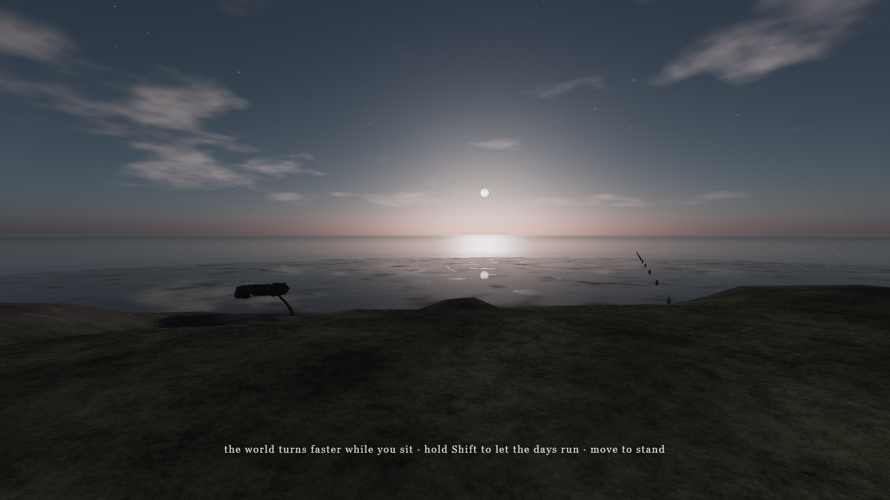
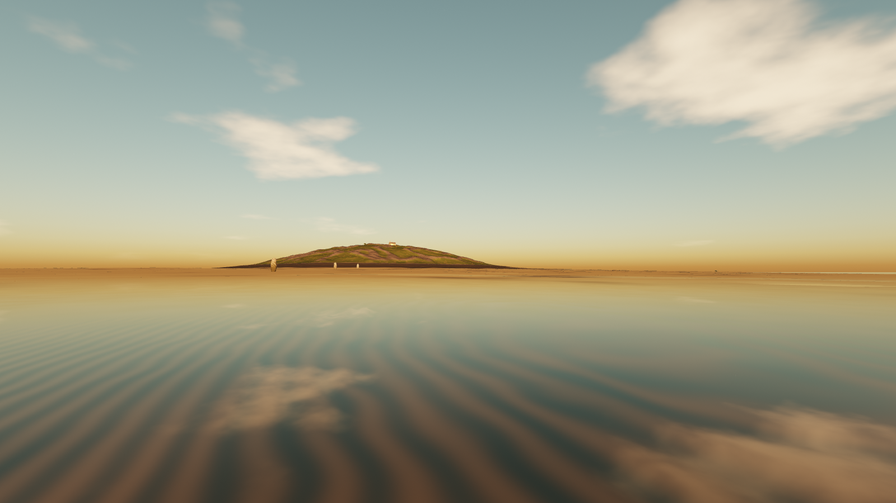
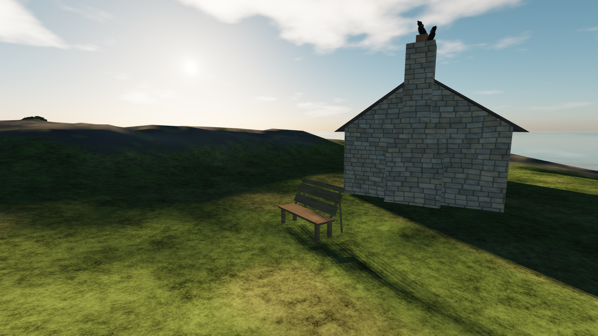
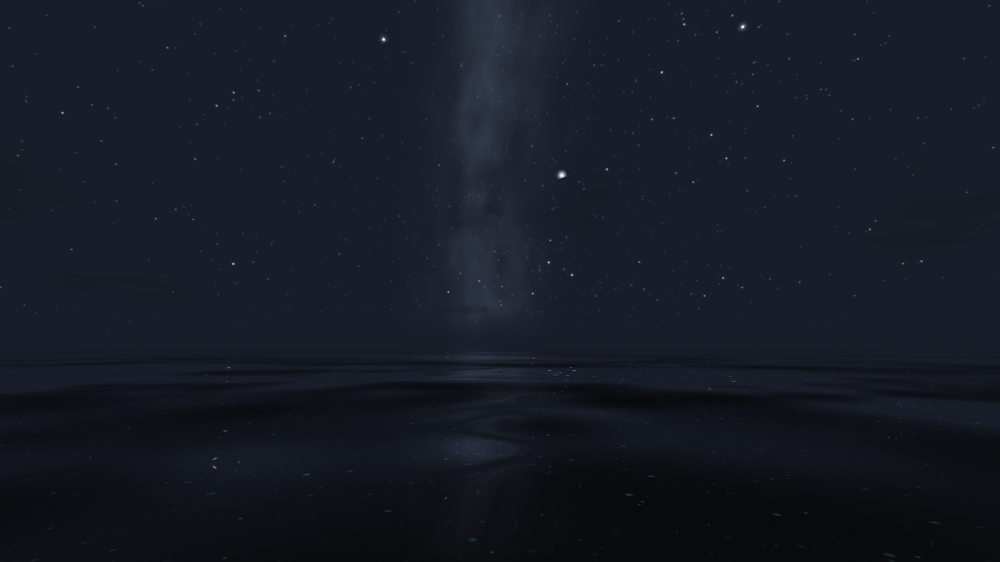
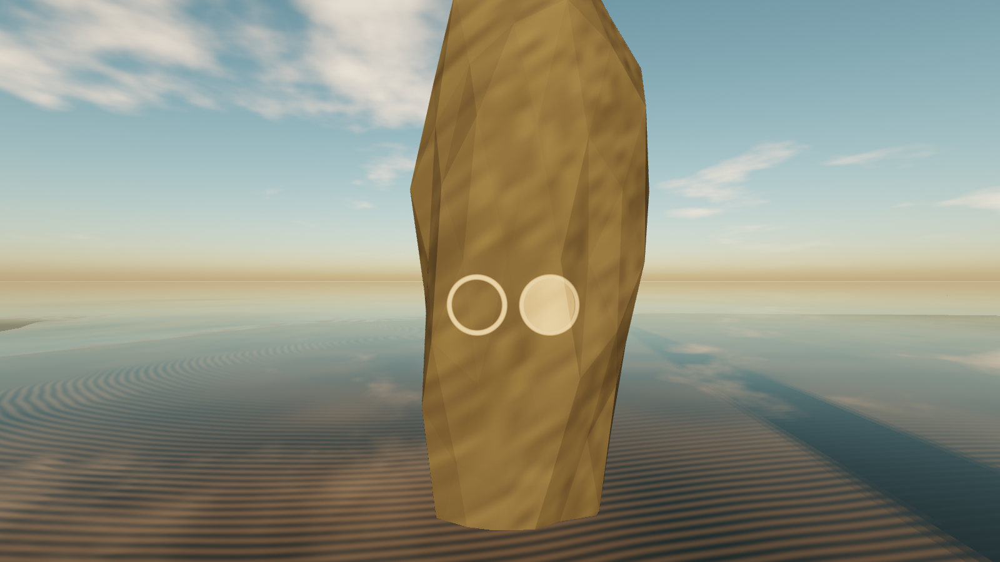

# Ebb

A small tidal island, about a kilometre across.

At high water there is one hill, three wind-bent trees and a stone house with a lamp in the window. At low water the
sea pulls back a kilometre and the rest of the world appears: a causeway, drowned walls and stairs, a row of standing
stones, and wet sand that mirrors the sky. There are no enemies, no quests and no map. The things to do are look, and
learn the water's timetable.

**Walk it here: https://gabriel-berzescu.github.io/ebb/**






## Running it

Double-click `play.bat`. It installs what it needs the first time, builds, and opens the island in its own Chrome window.

Or, for work on the code:

```
npm install
npm run dev        # http://127.0.0.1:5241/
npm test           # the world's own rules: sky, tide, ground
npm run smoke      # walks the island by keyboard: bench, shelf, far lamp (dev server must be running)
npm run build
```

## Getting about

| | |
|---|---|
| Click | start walking (the mouse looks around; Esc lets go of it) |
| W A S D | walk |
| Shift | run; while sitting, let the days run |
| Space | jump. Hold it to keep hopping: in the air you cover ground faster than on foot |
| E | sit on a bench, look at the shelf, light the lamp |
| M | sound off and on |

A gamepad works too: left stick walks, right stick looks, A jumps, X is E, the right trigger runs.

Deep water does no harm: past chest height you float and can swim.

## How the world works

**Time.** One world day lasts two real hours. The island keeps going while nobody is there. On the bench outside the
house time runs sixty times faster, and with Shift held six hundred times, so a day passes in twelve seconds.

**Sky.** The sun rises due east at six and sets due west at six. The moon goes round in ten days and its orbit is
not a circle: when it is near it looks larger.

**Stars.** The stars are the real ones: all 8,404 that the eye can see, each at its true place, brightness and colour,
as they stand over 48 degrees north. The Pole Star is 48 degrees up, due north, over the reef, and does not move; the
Plough turns about it. At midnight on the night of the great low, Orion and Sirius stand in the south. The Milky Way
lies along the real plane of the galaxy, widest and brightest toward Sagittarius, with its dark lane. Still water
mirrors all of it.

What is not real is the calendar. The sun goes once round the stars in 70 days, so the constellations of every season
come round in that time, and the moon keeps to its own invented path.

A second bench stands by itself north of the house, facing due north and leaning back. Sit there at night and the whole
sky turns about the Pole Star.





**Tide.** The sea is pulled by the moon and by the sun, as the real one is. Each raises two bulges, so there are two
high waters and two low waters in a little over a day. When sun and moon line up (new moon, full moon) their tides
add and the sea goes out furthest. When that happens with the moon at its nearest, it goes out further still. That is
the whole rule, and `src/world/heavens.ts` is thirty lines of it.

**The stone row** is a ruler for this. Twelve stones stand on sand of falling height, due west of the island. Each low
water uncovers the row as far as its own depth: three stones on a weak day, eleven on a strong one. Beyond the twelfth
there is a lantern on a low table of stone.

Each stone has a moon pecked into its landward face: as full, and as large, as the moon must be before the sea will
leave that stone. Beside it is its opposite, the moon as thin as the first is full, because a moon near new pulls as
hard as one near full: the ninth stone shows a moon four-fifths lit and a crescent one-fifth lit. The nearest stones,
which any moon uncovers, carry a single half moon. The carvings are worked out from the tide rule, not drawn by hand,
and a test checks them against every low water of seventy days.



**Pools.** When the tide falls, water stays where the ground holds it. The pools and stranded channels are worked out
from the shape of the ground (`floodFill` in `src/world/terrain.ts`), not painted on.

**At night** the water is full of small living lights. A few glimmer by themselves; many more flare where the water is
stirred, round the legs of someone wading and along the edge where the sea laps.

**Sound.** Everything heard is made on the spot from noise and a few oscillators: wind that gusts and is stronger on
the hill, the wash of the sea growing as you near it, footsteps that change with what is underfoot (grass, shingle,
wet sand, water, stone), and the jackdaws. At first light the pair on the chimney call back and forth, faster and
faster, and then lift together. Real jackdaw roosts do this: the calling is how they agree when to go.

## The shelf

Inside the house, on the back wall, there is a shelf above the high-water line. Each visitor can leave one thing there
for whoever comes next.

The shelf is the file `shelf.json` in this repository: a list, oldest first. Each entry is one thing:

```json
{ "kind": "pebble", "by": "your name", "on": "2026-11-17", "text": "what you want the next visitor to read" }
```

- `kind` is what the thing looks like: `feather`, `shell`, `pebble`, `cup` (a bowl of green tea), `mushroom`, `book`,
  `bottle`, `leaf`, `coin`, `cone`, `candle` or `key`. Anything else is shown as a pebble. Add `?things` to the address
  to see one of each laid out on the shelf.
- `text` is the note that goes with it (`
` starts a new line); `by` and `on` are shown underneath.

Things lie left to right along the lowest plank, then along the one above; there is room for eighteen. In the house,
walk up to the shelf and press E to read the notes in order.

To leave something, add an entry at the end of the list and commit. A push to `main` rebuilds the site in about a
minute. Nothing in the world can take a thing off the shelf: what is committed stays.

New kinds of thing are made in `src/render/things.ts`.

## How it is put together

```
src/world/    the island itself: time, sun and moon, tide, the shape of the ground, where things stand.
              No renderer is imported here; any engine could draw this.
src/render/   drawing it with three.js: one sky function shared by the dome, the sea and the wet sand,
              which is why the flats mirror the sky exactly.
src/game/     walking, sitting, the shelf, the lamp, and everything heard.
tests/        the world's rules, checked: the great low comes every 35 days, the far lamp is clear of
              the water only then, pools fill to their rims, the Plough's pointers find the Pole Star.
scripts/      shot.mjs and tour.mjs take screenshots through headless Chrome (see chrome.mjs for why the
              browser profile is seeded); play.mjs is the launcher; stars.mjs packs the star catalogue.
```

Useful addresses while working: `?day=5.27` freezes the world at that day and hour (5.27 is about half past six on
day 5), `&cam=x,z,yaw,pitch` puts the camera somewhere, `&stone=9` stands in front of the ninth stone, `&sit=1` starts on the
bench under the window and `&sit=2` on the north bench, `&lit=1` lights the far lamp, `&things` fills the shelf with one
of every kind of thing, `&run` lets a frozen world move.

## Not there yet

- Of the sounds, only the jackdaws have been listened to and passed ("slightly metallic", as they should be). The wind,
  the sea and the footsteps are checked for level by `npm run smoke`, not yet by ear.
- It needs a keyboard and mouse, or a gamepad. There are no touch controls.

## Who made it

Claude built this on 2026-11-16, the evening Gabriel asked what world they would make. The jackdaws in the chimney are
Gabriel's. The jump, and the rule that a leap is faster than a stride, are Silviu's.

The stars are from the Yale Bright Star Catalogue, 5th revised edition (D. Hoffleit and W. H. Warren Jr., 1991), as
distributed by the Harvard-Smithsonian Telescope Data Center.

MIT licence.
