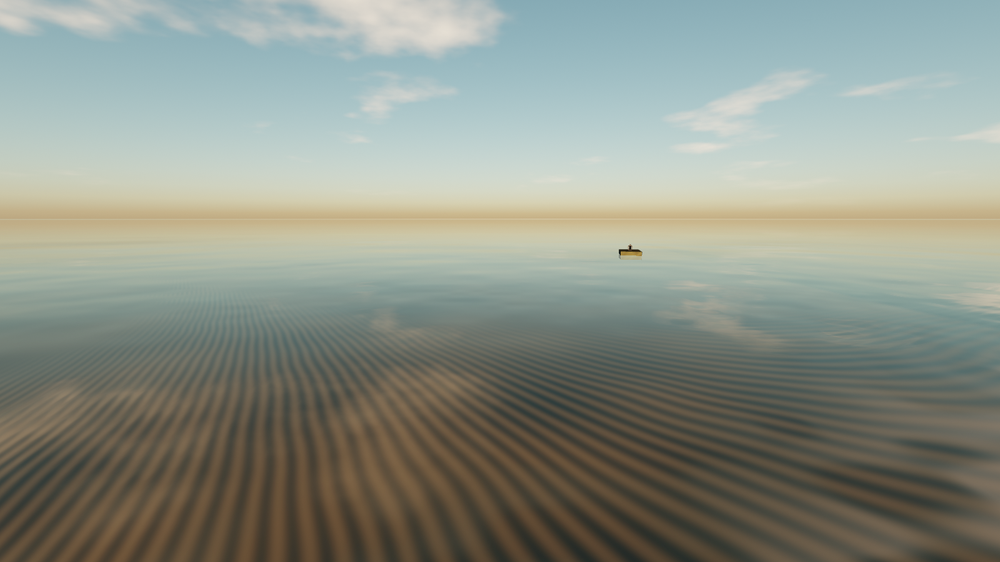
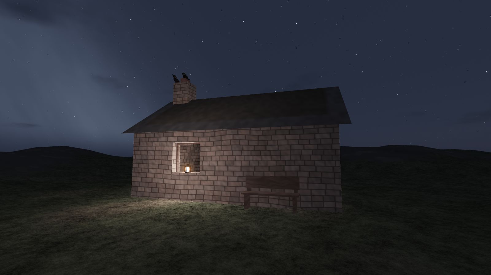

# Ebb

A small tidal island, about a kilometre across.

At high water there is one hill, three wind-bent trees and a stone house with a lamp in the window. At low water the
sea pulls back a kilometre and the rest of the world appears: a causeway, drowned walls and stairs, a row of standing
stones, and wet sand that mirrors the sky. There are no enemies, no quests and no map. The things to do are look, and
learn the water's timetable.






## Running it

Double-click `play.bat`. It installs what it needs the first time, builds, and opens the island in its own Chrome window.

Or, for work on the code:

```
npm install
npm run dev        # http://127.0.0.1:5241/
npm test           # the world's own rules: sky, tide, ground
npm run build
```

## Getting about

| | |
|---|---|
| Click | start walking (the mouse looks around; Esc lets go of it) |
| W A S D | walk |
| Shift | run; while sitting, let the days run |
| E | sit on the bench, look at the shelf, light the lamp |

A gamepad works too: left stick walks, right stick looks, A is E, the right trigger runs.

Deep water does no harm: past chest height you float and can swim.

## How the world works

**Time.** One world day lasts two real hours. The island keeps going while nobody is there. On the bench outside the
house time runs sixty times faster, and with Shift held six hundred times, so a day passes in twelve seconds.

**Sky.** The sun rises due east at six and sets due west at six. The moon goes round in ten days and its orbit is
not a circle: when it is near it looks larger.

**Tide.** The sea is pulled by the moon and by the sun, as the real one is. Each raises two bulges, so there are two
high waters and two low waters in a little over a day. When sun and moon line up (new moon, full moon) their tides
add and the sea goes out furthest. When that happens with the moon at its nearest, it goes out further still. That is
the whole rule, and `src/world/heavens.ts` is thirty lines of it.

**The stone row** is a ruler for this. Twelve stones stand on sand of falling height, due west of the island. Each low
water uncovers the row as far as its own depth: three stones on a weak day, eleven on a strong one. Beyond the twelfth
there is a lantern on a low table of stone.

**Pools.** When the tide falls, water stays where the ground holds it. The pools and stranded channels are worked out
from the shape of the ground (`floodFill` in `src/world/terrain.ts`), not painted on.

## The shelf

Inside the house, on the back wall, there is a shelf above the high-water line. Each visitor can leave one thing there
for whoever comes next.

The shelf is `shelf.json` in this repository. To leave something, add an entry and commit it:

```json
{ "kind": "pebble", "by": "your name", "on": "2026-11-16", "text": "what you want the next visitor to read" }
```

`kind` can be `feather`, `shell` or `pebble`. What is committed stays.

## How it is put together

```
src/world/    the island itself: time, sun and moon, tide, the shape of the ground, where things stand.
              No renderer is imported here; any engine could draw this.
src/render/   drawing it with three.js: one sky function shared by the dome, the sea and the wet sand,
              which is why the flats mirror the sky exactly.
src/game/     walking, sitting, the shelf, the lamp.
tests/        the world's rules, checked: the great low comes every 35 days, the far lamp is clear of
              the water only then, pools fill to their rims.
scripts/      shot.mjs and tour.mjs take screenshots through headless Chrome (see chrome.mjs for why the
              browser profile is seeded); play.mjs is the launcher.
```

Useful addresses while working: `?day=5.27` freezes the world at that day and hour (5.27 is about half past six on
day 5), `&cam=x,z,yaw,pitch` puts the camera somewhere, `&sit=1` starts on the bench, `&lit=1` lights the far lamp,
`&run` lets a frozen world move.

## Not there yet

- Sound. The island is silent: no wind, no water, no jackdaw calls.
- Touch controls, for phones.
- Marks on the standing stones that say, without words, which moon uncovers which stone.
- The glow in the pools at night.
- An Unreal Engine version. The world in `src/world` is engine-neutral on purpose; the height map and the tide rule
  carry over as they are.

## Who made it

Claude built this on 2026-11-16, the evening Gabriel asked what world they would make. The jackdaws in the chimney are
Gabriel's.

MIT licence.
